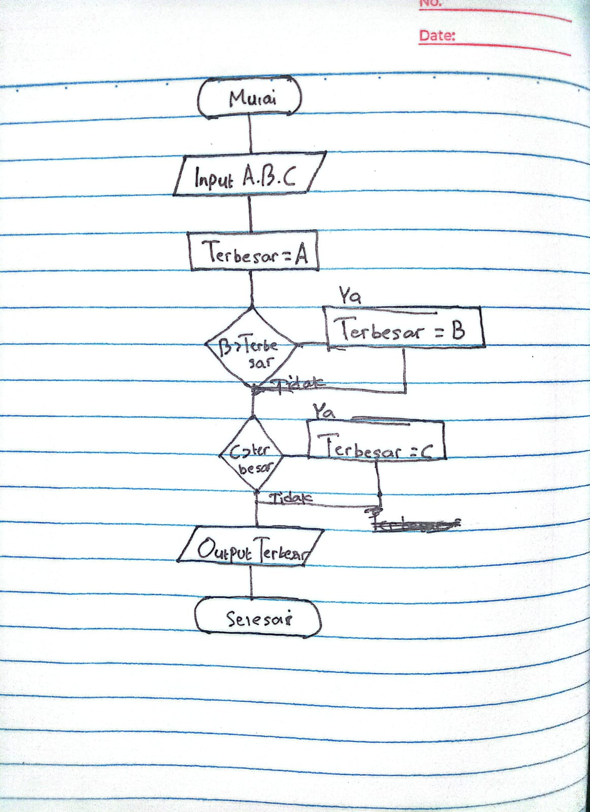

# P04 Percabangan: if, if-else, switch, dan Operator Logika

Folder kode Pertemuan 4 Pemrograman Terstruktur. Setiap program di sini punya flowchart pasangannya
di modul (Gambar 2 sampai 7); baca gambarnya dulu, baru kodenya.

## Isi

| Berkas | Kegunaan |
|---|---|
| `if_dasar.cpp` | if satu cabang: peringatan bila nilai di bawah 60 |
| `if_else.cpp` | if-else: lulus atau belum lulus |
| `bertingkat.cpp` | if-else bertingkat tiga syarat; coba tukar urutannya |
| `logika.cpp` | `&&`, `||`, `!` dengan bool bernama; syarat ikut UAS |
| `switch_menu.cpp` | switch dengan break dan default; coba hapus break-nya |
| `sinilai_v03_awal.cpp` | Starter SiNilai v0.3: bagian v0.2 sudah jadi, lengkapi huruf mutu, status, keterangan |
| `contoh_masukan.txt` | Masukan uji yang sama dengan pertemuan sebelumnya |
| `.vscode/`, `.gitignore` | Sama dengan pertemuan sebelumnya |

## Kasus uji SiNilai v0.3

| Empat komponen | Nilai akhir | Huruf | Keterangan | Status |
|---|---|---|---|---|
| contoh_masukan.txt | 83.975 | A | Sangat baik | Lulus |
| 80 x4 | 80 | A | Sangat baik | Lulus |
| 79.9 x4 | 79.9 | B+ | Baik | Lulus |
| 60 x4 | 60 | C | Cukup | Lulus |
| 59.9 x4 | 59.9 | D | Kurang | Belum lulus |
| 30 x4 | 30 | E | Sangat kurang | Belum lulus |

## Yang dikumpulkan mahasiswa

Folder `p04` di repository `pt-NPM` berisi `sinilai_v03.cpp` dan  `README.md`. Lihat Modul Pertemuan 4 bagian E.

## Deklarasi AI

Tidak Menggunakan AI

# Latihan Mandiri

## NO 1

Perbandingan dengan Gambar

Flowchart yang saya buat memiliki pola yang sama dengan Gambar 4, yaitu menggunakan percabangan untuk memeriksa nilai secara berurutan. Bagian yang berulang adalah simbol keputusan berbentuk belah ketupat dengan dua pilihan, yaitu Ya dan Tidak. Jika kondisi benar, program menentukan huruf mutu. Jika salah, program melanjutkan ke kondisi berikutnya sampai menemukan huruf mutu yang sesuai.

Perbedaannya, flowchart saya memiliki tujuh kemungkinan hasil, yaitu A, B+, B, C+, C, D, dan E, sehingga pemeriksaan kondisinya lebih banyak.

## NO 2

#include <iostream>
using namespace std;

int main() {
    double a, b, c;
    double terbesar;

    cout << "Masukkan angka pertama : ";
    cin >> a;

    cout << "Masukkan angka kedua   : ";
    cin >> b;

    cout << "Masukkan angka ketiga  : ";
    cin >> c;

    terbesar = a;

    if (b > terbesar) {
        terbesar = b;
    }

    if (c > terbesar) {
        terbesar = c;
    }

    cout << "\nBilangan terbesar adalah: " << terbesar << "\n";

    return 0;
}

## NO 3

#include <iostream>
using namespace std;

int main() {
    int tahun;

    cout << "=== Program Tahun Kabisat ===\n";
    cout << "Masukkan tahun: ";
    cin >> tahun;

    if ((tahun % 4 == 0 && tahun % 100 != 0) ||
        (tahun % 400 == 0)) {
        cout << tahun << " adalah tahun kabisat.\n";
    } else {
        cout << tahun << " bukan tahun kabisat.\n";
    }

    return 0;
}

## NO 4

Perubahan yang terjadi adalah tipe data variabel `pilihan` yang awalnya `int` menjadi `char`. Karena menggunakan tipe data `char`, nilai pada setiap `case` harus ditulis menggunakan tanda petik satu, misalnya `case 1:` menjadi `case '1':`.

Selain itu, saya menambahkan `case 'k':` sebagai pilihan untuk keluar dari program. Jadi, pengguna bisa memilih angka 3 atau huruf k untuk keluar.

## NO 5

Hasilnya tidak persis sama. Pada program if-else bertingkat, nilai 79.9 menghasilkan huruf mutu B+, sedangkan pada program switch menghasilkan B.

Hal ini terjadi karena `static_cast<int>(nilai)` mengubah nilai desimal menjadi bilangan bulat dengan membuang bagian desimalnya. Setelah dibagi 10, nilai 79.9 masuk ke `case 7`. Akibatnya, program switch tidak dapat membedakan nilai 70 dengan 79.9 jika hanya menggunakan kelompok puluhan.

Jadi, penggunaan if-else bertingkat lebih sesuai untuk menentukan huruf mutu yang memiliki batas nilai seperti 75 dan 65.